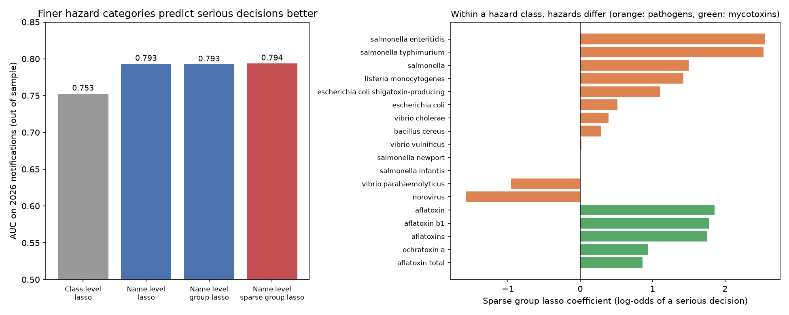
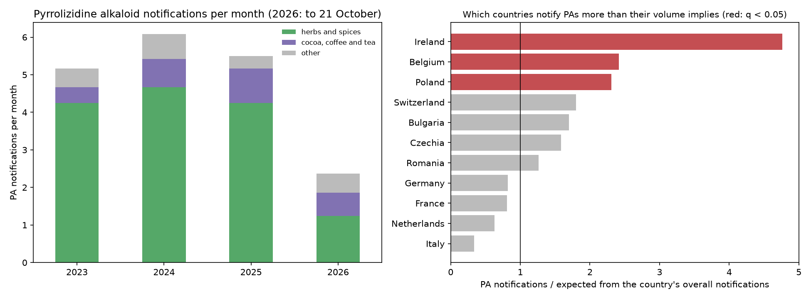

# Network analysis of EU food-safety alerts (RASFF)

**Technical report (7 pages, PDF):** [report/RASFF_Technical_Report_Guilarte_Homayden.pdf](report/RASFF_Technical_Report_Guilarte_Homayden.pdf)

A small, reproducible study of which **origin countries, product categories and hazards** sit at the center of EU food-safety notifications, and **how stable those rankings are** under resampling and over time. It then tests which links exceed what volume alone predicts (step 5), compares hazard categorizations for predicting regulatory risk decisions with the sparse group lasso (step 6), and studies pyrrolizidine alkaloids as a case (step 7).

## Question

Which products and hazards are most central in EU RASFF notifications, and are those rankings robust enough to support monitoring priorities?

## Data

- **Source:** EU Rapid Alert System for Food and Feed, public [RASFF Window](https://webgate.ec.europa.eu/rasff-window/screen/search), exported on 22 October 2026.
- **Sample:** 19,801 notifications from 2 January 2023 to 21 October 2026. The analysis keeps the **13,068 food notifications with at least one coded hazard** (feed and food-contact notifications, and labeling-only cases without a coded hazard, are excluded).
- **Coverage:** 141 origin countries, 33 product categories, 28 hazard classes (931 distinct hazards).
- **Cleaning:** the `hazards` field lists one or more hazards per notification as `name - {class}`; it is parsed into separate hazard records. Notifications with several origin countries are split by country.

## Method

1. **Two-layer network.** Layer 1 links *origin country – product category*; layer 2 links *product category – hazard class*. Edge weights count notifications. Product categories connect the two layers (202 nodes, 1,443 weighted edges).
2. **Centrality.** Weighted degree (strength) and PageRank on the combined network; communities of products that share hazards (Louvain on the weighted product projection).
3. **Uncertainty.** 1,000 bootstrap resamples of notifications give a 90% interval for each node's PageRank and the share of resamples in which it stays in the top 10.
4. **Temporal robustness.** Spearman rank correlation of PageRank between consecutive years.

## Results

- **Three hazard classes dominate the network:** pesticide residues, pathogenic micro-organisms and mycotoxins rank in the top three in 100% of the 1,000 bootstrap resamples.
- **The strongest links are product-specific:** fruits and vegetables – pesticide residues (2,168 notifications), poultry meat – pathogenic micro-organisms (1,414) and nuts and seeds – mycotoxins (1,204). On the origin side, Türkiye – fruits and vegetables (1,110) and Poland – poultry meat (661) are the strongest links.
- **Products split into two communities** by the hazards they share: mostly animal-origin products (poultry and other meat, eggs, milk, molluscs) linked to microbiological hazards, and plant-based and processed products (fruits and vegetables, nuts, spices, cereals) linked to chemical hazards.
- **The top of the ranking is robust; the boundary is not.** Rankings are stable across years (Spearman ρ = 0.90–0.94), but nodes near the top-10 cut-off are uncertain: *novel food* stays in the hazard top 10 in only 90% of resamples (*biological contaminants* enters in 10%), and *cocoa, coffee and tea* stays in the product top 10 in 94% (*confectionery* enters in 7%). Priorities set only by a ranking should not treat these boundary positions as fixed.
- **Network position differs from raw counts.** Some nodes rank differently by PageRank than by notification counts (e.g. *milk and milk products* is 12th by count but 15th by PageRank), because centrality also depends on what a node is connected to.


## Which links are stronger than volume alone predicts?

Raw counts mix product-specific risk with sheer volume: an origin or product that is notified often will have many links regardless of risk. Step 5 separates the two with a null model and validates the result out of sample.

- **Null model per layer.** For each origin–product and product–hazard link, a hypergeometric test asks whether the count exceeds what the two margins imply (statistically validated networks, Tumminello et al., 2011).
- **Coupling between layers.** For each origin–product–hazard triple, the null is that origin and hazard are independent given the product, so the layers interact only through the product node. A rejected null is an origin-specific hazard profile that neither layer shows alone.
- **Multiple testing.** Benjamini–Hochberg false discovery rate of 1% across all links.
- **Out-of-sample check.** Links are validated on 2023–2025 and tested on 2026 notifications, with expected counts recomputed from 2026 margins.

| Layer | Links | Validated (2023–2025) | Over-represented in 2026: validated | Over-represented in 2026: not validated |
|---|---|---|---|---|
| Origin–product | 970 | 135 | 86% (observed/expected 3.51) | 30% (0.66) |
| Product–hazard | 350 | 77 | 82% (2.92) | 25% (0.48) |
| Origin–product–hazard | 2,341 | 144 | 75% (1.70) | 32% (0.94) |

- **Some of the largest links are explained by volume.** Türkiye – nuts (146 notifications, 0.82 of expected), India – fruits and vegetables (111, 0.61) and fruits and vegetables – mycotoxins (498, 1.11) are not over-represented once margins are accounted for.
- **Smaller links carry specific signals.** Ecuador – crustaceans (82 notifications, 33 times expected), Pakistan – cereals (194, 11 times), fish – parasitic infestation (43, 19 times) and cephalopods – heavy metals (24, 18 times).
- **Layer coupling changes the reading of the largest node.** Türkiye – fruits and vegetables – pesticide residues is the largest triple (387) but sits below expectation (0.72), while Türkiye – fruits and vegetables – mycotoxins is 2.6 times expected: Türkiye's fruit and vegetable notifications are more about mycotoxins than the product layer alone suggests.
- **Implication for monitoring.** Ranking by raw counts and ranking by deviation from a null model answer different questions; validated links are the ones that persist out of sample.


## Does the way hazards are categorized matter for decisions? (step 6)

Risk categorizations are a modelling choice. Following the approach of Stevens, Almeida et al. (2025), who compare diet categorizations for predicting disease flares with the sparse group lasso, step 6 asks whether coarse or fine hazard categories better predict which notifications receive a **"serious" risk decision** (57% of the 13,068 notifications).

- **Predictors.** Product category (33), origin country (top 25 plus "other"), and hazards at one of two levels: the 28 hazard classes, or 118 named hazards (at least 20 notifications in 2023–2025, spelling variants merged) plus one "other hazards in this class" indicator per class.
- **Models.** Penalized logistic regression: lasso on classes; lasso on names; group lasso on names grouped by class; and sparse group lasso (Simon et al., 2013), which selects classes and, inside each selected class, the hazards that matter. Solver: proximal gradient with FISTA, written for this project (`src/sgl.py`) and checked against scikit-learn on the unpenalized fit.
- **Validation.** Penalty chosen on 2025 (models fitted on 2023–2024); final models fitted on 2023–2025 and evaluated on the 3,002 notifications of 2026. Paired bootstrap (1,000 resamples) for the difference in AUC.

| Model (hazard level) | Hazard features selected | AUC 2026 | Log loss 2026 | AUC gain vs. classes (90% interval) |
|---|---|---|---|---|
| Lasso (28 classes) | 18 of 28 | 0.753 | 0.590 | – |
| Lasso (names) | 118 of 146 | 0.793 | 0.554 | +0.041 (0.030 to 0.051) |
| Group lasso (names by class) | 140 of 146 | 0.793 | 0.553 | +0.040 (0.030 to 0.049) |
| Sparse group lasso (names by class) | 132 of 146 | 0.794 | 0.553 | +0.041 (0.031 to 0.051) |

- **Finer categories predict decisions better out of sample** (+0.04 AUC, interval excluding zero). The group structure does not add accuracy here; its value is interpretability, since it reports which classes matter and which hazards within them.
- **Hazards within a class are treated very differently.** *Salmonella* Enteritidis and Typhimurium have the largest positive coefficients, while *Salmonella* Infantis is shrunk to zero. In the raw data, 83% of the 321 Enteritidis notifications and 85% of the 108 Typhimurium notifications are classified as serious, against 30% of the 351 Infantis notifications, although all three are mostly in poultry meat (82–94%). This matches EU law: Enteritidis and Typhimurium are the serovars with a food-safety criterion for fresh poultry meat (absence in 25 g, Regulation (EC) No 2073/2005, row 1.28, added by Regulation (EU) No 1086/2011). Norovirus and *Vibrio parahaemolyticus* have negative coefficients within the same class.
- **Implication.** A network or risk model built on hazard classes merges hazards that regulators treat differently. The hazard level should be chosen, and validated, for the decision the model supports.



## Case study: pyrrolizidine alkaloids (step 7)

Pyrrolizidine alkaloids (PAs) are plant toxins found mainly in herbs, spices, teas and herbal infusions. EU maximum levels apply from 1 July 2022 (Commission Regulation (EU) 2020/2040), with a transition for products placed on the market earlier until 31 December 2023.

- **224 PA notifications** (2023 to 21 October 2026): 170 in herbs and spices, 31 in cocoa, coffee and tea, 8 in food supplements. Main origins: Türkiye (79), Poland (29), India (21).
- **Over-represented origins within herbs and spices** (hypergeometric test, Benjamini–Hochberg): Türkiye (76 of its 127 herbs-and-spices notifications are PAs, 3.5 times the expected share, q < 0.001), Poland (2.9 times) and Greece (9 of 9). India is under-represented (0.4 times): its herbs-and-spices notifications concern other hazards.
- **Who notifies.** **Belgium is the first notifying country for PAs** (34 notifications, 2.4 times what its overall volume implies, q < 0.001), with Ireland (4.8 times) and Poland (2.3 times). Germany, France, the Netherlands and Italy notify PAs less than their volume implies. Notifications therefore reflect national control priorities as well as contamination.
- **Risk decisions.** PA notifications are classified as serious more often than other hazards in the same product category: 65% vs. 56% in herbs and spices (Fisher p = 0.03) and 61% vs. 36% in cocoa, coffee and tea (p = 0.01).
- **Over time.** The end of the transition did not change the rate (2.1% of notifications in 2023, 1.6% in 2024 to 2026, p = 0.10). The fall is concentrated in 2026: 2.4 PA notifications per month against 5.2 to 6.1 in 2023–2025 (0.8% of notifications against 2.0%, p < 0.001). RASFF alone cannot say whether this reflects lower contamination, fewer controls or changes in sampling.
- **What an exposure layer would need.** RASFF records non-compliant lots, not concentrations in what people eat. Turning this network into a risk model for PAs requires occurrence data (concentrations in herbs, teas and infusions) and consumption data by population group, the kind of data held by national institutes such as Sciensano, linked to the product nodes of the network.



## Limitations

- RASFF notifications reflect **what is inspected and reported**, not the true prevalence of contamination. Central nodes partly reflect inspection intensity (for example, reinforced border controls on specific products and origins).
- The network uses broad hazard classes; step 6 shows that the hazard-name level (931 hazards, 118 with at least 20 notifications) carries information that classes merge.
- Risk decisions are made by the notifying authority with information not in the public export (for example, measured concentrations and the distribution of the product), so the models in step 6 describe how decisions relate to the categories, not why they were made.
- Counts do not include consumption volumes or exposure, which would be needed for a risk assessment; this is a screening and prioritization exercise, not a risk estimate.

## Reproduce

```bash
pip install -r requirements.txt
# put the RASFF Window export (.xlsx or .csv) in data/raw/
cd src
python step1_load_clean.py
python step2_network.py
python step3_uncertainty.py      # about 5–10 minutes (1,000 bootstrap resamples)
python step4_figures.py
python step5_validated_links.py  # null model, false discovery rate and out-of-sample check
python step6_hazard_categorization.py   # lasso, group lasso and sparse group lasso (about 30 seconds)
python step7_pyrrolizidine_alkaloids.py
python step8_figures_extension.py
```

## References

- Commission Regulation (EU) 2020/2040 of 11 December 2020 amending Regulation (EC) No 1881/2006 as regards maximum levels of pyrrolizidine alkaloids in certain foodstuffs.
- Commission Regulation (EU) No 1086/2011 of 27 October 2011 amending Regulation (EC) No 2073/2005 as regards salmonella in fresh poultry meat.
- Simon, N., Friedman, J., Hastie, T., and Tibshirani, R. (2013). A sparse-group lasso. *Journal of Computational and Graphical Statistics*, 22(2), 231–245.
- Stevens, C. L., Almeida, R. J., et al. (2025). Exploring diet categorizations and their influence on flare prediction in inflammatory bowel disease, using the Sparse Grouped Least Absolute Shrinkage and Selection Operator method. *Clinical Nutrition*, 47, 212–226.
- Tumminello, M., Miccichè, S., Lillo, F., Piilo, J., and Mantegna, R. N. (2011). Statistically validated networks in bipartite complex systems. *PLoS ONE*, 6(3), e17994.

Author: Eugenio Guilarte Homayden
