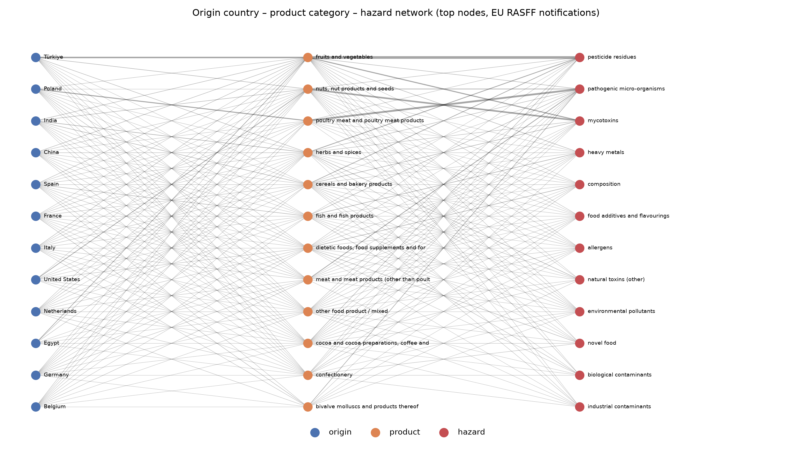
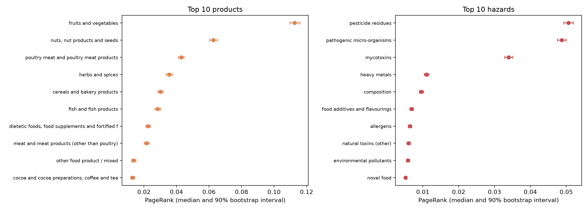
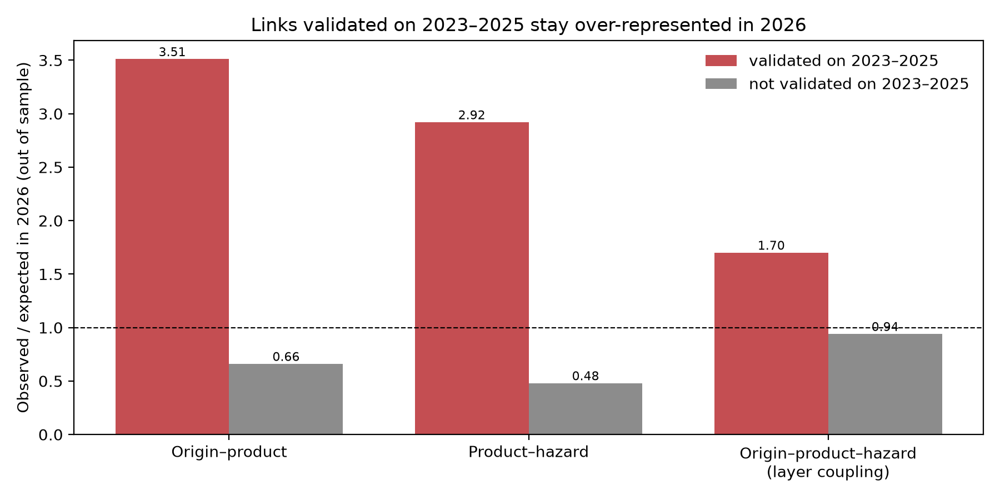

# Network analysis of EU food-safety alerts (RASFF)

**Technical report (5 pages, PDF):** [report/RASFF_Technical_Report_Guilarte_Homayden.pdf](report/RASFF_Technical_Report_Guilarte_Homayden.pdf)

A small, reproducible study of which **origin countries, product categories and hazards** sit at the centre of EU food-safety notifications, and **how stable those rankings are** under resampling and over time.

## Question

Which products and hazards are most central in EU RASFF notifications, and are those rankings robust enough to support monitoring priorities?

## Data

- **Source:** EU Rapid Alert System for Food and Feed, public [RASFF Window](https://webgate.ec.europa.eu/rasff-window/screen/search), exported on 22 October 2026.
- **Sample:** 19,801 notifications from 2 January 2023 to 21 October 2026. The analysis keeps the **13,068 food notifications with at least one coded hazard** (feed and food-contact notifications, and labelling-only cases without a coded hazard, are excluded).
- **Coverage:** 141 origin countries, 33 product categories, 28 hazard classes (931 distinct hazards).
- **Cleaning:** the `hazards` field lists one or more hazards per notification as `name - {class}`; it is parsed into separate hazard records. Notifications with several origin countries are split by country.

## Method

1. **Two-layer network.** Layer 1 links *origin country – product category*; layer 2 links *product category – hazard class*. Edge weights count notifications. Product categories connect the two layers (202 nodes, 1,443 weighted edges).
2. **Centrality.** Weighted degree (strength) and PageRank on the combined network; communities of products that share hazards (Louvain on the weighted product projection).
3. **Uncertainty.** 1,000 bootstrap resamples of notifications give a 90% interval for each node's PageRank and the share of resamples in which it stays in the top 10.
4. **Temporal robustness.** Spearman rank correlation of PageRank between consecutive years.

## Results

- **Three hazard classes dominate the network:** pesticide residues, pathogenic micro-organisms and mycotoxins rank in the top three in 100% of the 1,000 bootstrap resamples.
- **The strongest links are product-specific:** fruits and vegetables – pesticide residues (2,168 notifications), poultry meat – pathogenic micro-organisms (1,414) and nuts and seeds – mycotoxins (1,204). On the origin side, Türkiye – fruits and vegetables (1,110) and Poland – poultry meat (661) are the strongest links.
- **Products split into two communities** by the hazards they share: mostly animal-origin products (poultry and other meat, eggs, milk, molluscs) linked to microbiological hazards, and plant-based and processed products (fruits and vegetables, nuts, spices, cereals) linked to chemical hazards.
- **The top of the ranking is robust; the boundary is not.** Rankings are stable across years (Spearman ρ = 0.90–0.94), but nodes near the top-10 cut-off are uncertain: *novel food* stays in the hazard top 10 in only 90% of resamples (*biological contaminants* enters in 10%), and *cocoa, coffee and tea* stays in the product top 10 in 94% (*confectionery* enters in 7%). Priorities set only by a ranking should not treat these boundary positions as fixed.
- **Network position differs from raw counts.** Some nodes rank differently by PageRank than by notification counts (e.g. *milk and milk products* is 12th by count but 15th by PageRank), because centrality also depends on what a node is connected to.




## Which links are stronger than volume alone predicts?

Raw counts mix product-specific risk with sheer volume: an origin or product that is notified often will have many links regardless of risk. Step 5 separates the two with a null model and validates the result out of sample.

- **Null model per layer.** For each origin–product and product–hazard link, a hypergeometric test asks whether the count exceeds what the two margins imply (statistically validated networks, Tumminello et al., 2011).
- **Coupling between layers.** For each origin–product–hazard triple, the null is that origin and hazard are independent given the product, so the layers interact only through the product node. A rejected null is an origin-specific hazard profile that neither layer shows alone.
- **Multiple testing.** Benjamini–Hochberg false discovery rate of 1% across all links.
- **Out-of-sample check.** Links are validated on 2023–2025 and tested on 2026 notifications, with expected counts recomputed from 2026 margins.

| Layer | Links | Validated (2023–2025) | Over-represented in 2026: validated | Over-represented in 2026: not validated |
|---|---|---|---|---|
| Origin–product | 970 | 135 | 86% (observed/expected 3.51) | 30% (0.66) |
| Product–hazard | 350 | 77 | 82% (2.92) | 25% (0.48) |
| Origin–product–hazard | 2,341 | 144 | 75% (1.70) | 32% (0.94) |

- **Some of the largest links are explained by volume.** Türkiye – nuts (146 notifications, 0.82 of expected), India – fruits and vegetables (111, 0.61) and fruits and vegetables – mycotoxins (498, 1.11) are not over-represented once margins are accounted for.
- **Smaller links carry specific signals.** Ecuador – crustaceans (82 notifications, 33 times expected), Pakistan – cereals (194, 11 times), fish – parasitic infestation (43, 19 times) and cephalopods – heavy metals (24, 18 times).
- **Layer coupling changes the reading of the largest node.** Türkiye – fruits and vegetables – pesticide residues is the largest triple (387) but sits below expectation (0.72), while Türkiye – fruits and vegetables – mycotoxins is 2.6 times expected: Türkiye's fruit and vegetable notifications are more about mycotoxins than the product layer alone suggests.
- **Implication for monitoring.** Ranking by raw counts and ranking by deviation from a null model answer different questions; validated links are the ones that persist out of sample.



## Limitations

- RASFF notifications reflect **what is inspected and reported**, not the true prevalence of contamination. Central nodes partly reflect inspection intensity (for example, reinforced border controls on specific products and origins).
- The network uses broad hazard classes; the hazard-name level (931 hazards) is available in the cleaned data (`HAZARD_LEVEL` in `src/config.py`) but is sparser.
- Counts do not include consumption volumes or exposure, which would be needed for a risk assessment; this is a screening and prioritization exercise, not a risk estimate.

## Reproduce

```bash
pip install -r requirements.txt
# put the RASFF Window export (.xlsx or .csv) in data/raw/
cd src
python step1_load_clean.py
python step2_network.py
python step3_uncertainty.py      # about 5–10 minutes (1,000 bootstrap resamples)
python step4_figures.py
python step5_validated_links.py  # null model, false discovery rate and out-of-sample check
```

Reference: Tumminello, M., Miccichè, S., Lillo, F., Piilo, J., and Mantegna, R. N. (2011). Statistically validated networks in bipartite complex systems. *PLoS ONE*, 6(3), e17994.

Author: Eugenio Guilarte Homayden
